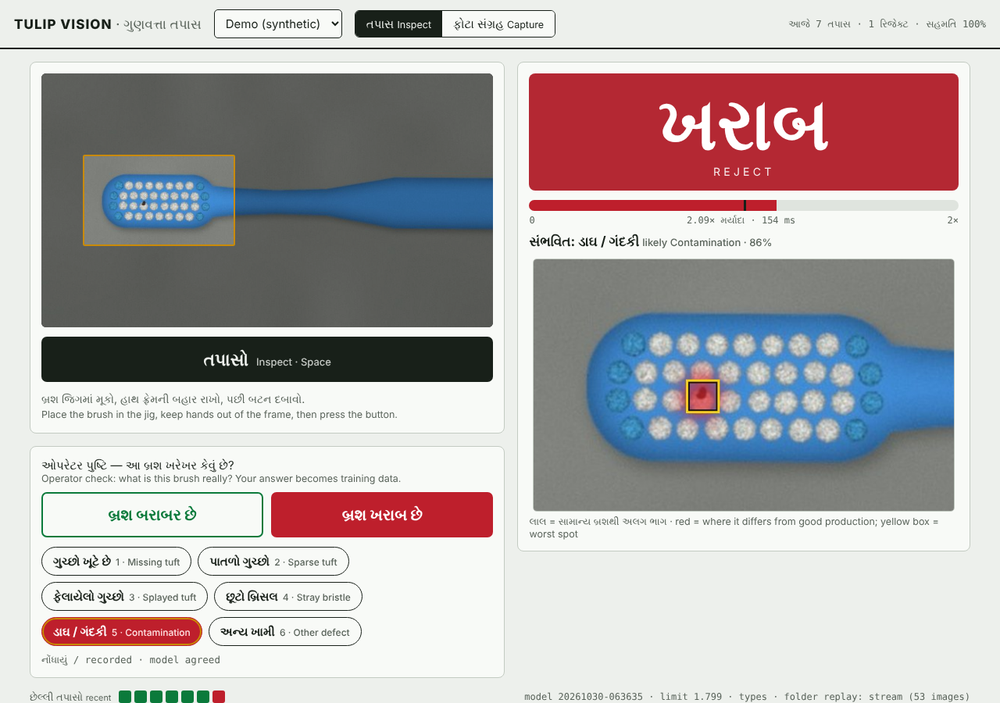
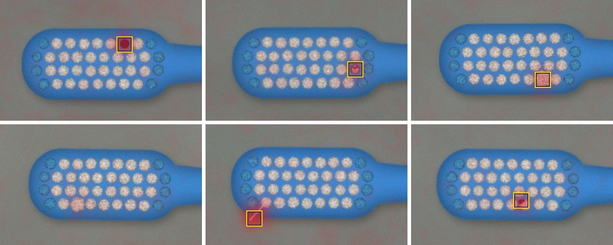
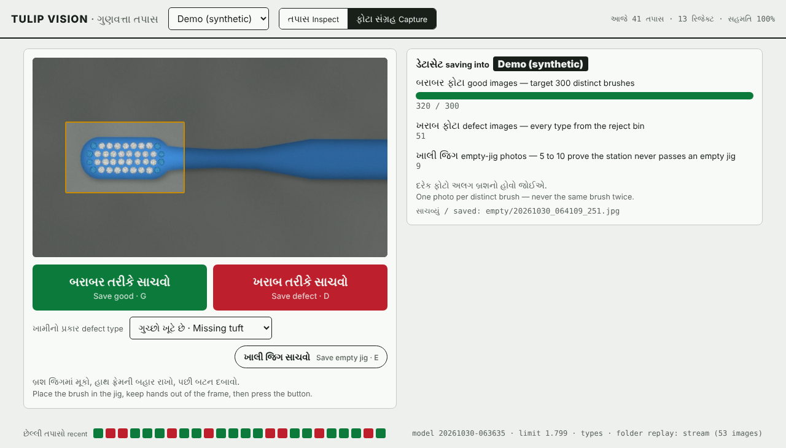
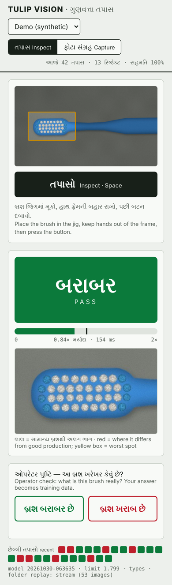

# Tulip Vision — visual quality inspection for toothbrush production

Automated defect detection for Tulip Enterprise, Vadodara. A camera over a
jig photographs each brush head after **tufting and trimming** — the steps
the factory owns — and the station answers **બરાબર / ખરાબ** (pass / reject)
in about a tenth of a second, shows *where* it looks wrong, names the likely
defect type, and asks the operator to confirm. Every confirmation becomes
training data.

Runs **fully offline** on the factory LAN, on the same Flask + Waitress stack
as Tulip Ops, with a **Gujarati-first** operator screen that works from the
inspection PC, a tablet or any phone on the network.


<sub>Operator station on the synthetic demo SKU: verdict, score against the limit, heatmap with the worst spot boxed, likely defect type, one-tap confirmation.</sub>

---

## How it works

```
 camera ─► same-size frame ─► brush-head ROI ─► frozen ResNet18 ─► patch features
                                                                       │
     recognition: does this look like a brush in the jig at all? ◄─────┤  (empty jig, changed camera
                                                                       │   picture → never a pass)
     patch check: distance to the nearest GOOD patch ◄─────────────────┘  (memory bank built from
                                                                          good images only)
 worst patch vs limit ─► બરાબર / ખરાબ + heatmap + likely defect type ─► operator confirms
                                                                     └─► image filed into the dataset
```

**Why anomaly detection first.** A supervised classifier needs hundreds of
labelled photos per defect type, and a production line by design makes very
few defects. What it makes in unlimited quantity is *good* brushes. So the
model learns what good production looks like (PatchCore, Roth et al. 2022:
frozen ImageNet backbone → patch memory bank → nearest-neighbour distance)
and flags any brush that deviates — including defect types nobody listed.
About 300 photos of good brushes train it. Defects are only ever used to
*measure* it.

**A pass has to be earned.** Two checks stand between a frame and a
બરાબર. The *recognition* check compares one summary of the whole head with
every training brush: an empty jig, or a picture that changed too much
(focus, light, camera), comes back **ઓળખાયું નથી / not recognised**, never
a pass. The *patch* check then looks for any small region unlike good
production; a misplaced brush or another handle colour fails there. A camera
feed that froze (even a second ago), a frame of a different size, or a model
that fails to load is refused rather than judged. Neither check reads the
SKU — a different model with the same colours and similar tufts can look
normal — so the operator picks the SKU on screen.

**The classifier names the defect.** Once operators have labelled a few dozen
rejects per type, a small classifier on the same frozen features names the
defect ("missing tuft, 96%"). It trains automatically with the anomaly model
whenever `data/<sku>/classes/` has enough examples.

## Quickstart — the whole system in ten minutes, no hardware

```bash
python -m venv .venv
.venv\Scripts\activate            # Windows   (Linux/macOS: source .venv/bin/activate)
pip install -r requirements.txt
python -m pytest -q                                   # 74 tests, about a minute

python scripts/make_synthetic.py                      # ~2 min: good brushes, planted defects, empty jig
python scripts/train_anomaly.py --sku demo_synthetic  # ~2 min; downloads ResNet18 weights once (45 MB)
python serve/app.py --camera folder:data/demo_synthetic/stream
```

Open **http://localhost:8600**, pick *Demo (synthetic)*, press **Space**.
The demo camera replays a shuffled mix of good, defective and empty-jig
frames and moves to the next one two seconds after each inspection.

## On the factory floor

**1. Build the rig — it matters more than the model.** Camera clamped
straight down, brush in a jig with an end-stop, diffuse light (lamp through
butter paper), matte grey background, no window light. A phone in a clamp
running a webcam app (Iriun, DroidCam) over USB is a fine v1 camera. Frame
the head large: tufts are what the model has to see. Set the camera index
and resolution in `config.yaml` (`camera.source`, `width`, `height`) and
keep them fixed from now on.

**2. Collect the dataset.** Start the station (`python serve/app.py`), open
the **ફોટા સંગ્રહ / Capture** tab, then **G** for each good brush, **D**
(with the defect type) for each reject, and **E** for 5–10 photos of the
empty jig. Or use the keyboard tool: `python scripts/capture.py --sku zecta_classic`.

- **300+ different brushes**, one photo each — never the same brush twice.
  The model learns production's normal variation from distinct units.
- Normal passed production, not showpieces: the good set defines the pass band.
- One handle colour per SKU. Every colour variant is its own SKU.
- 20–30 rejects across every defect type, defect facing the camera.

Images land in `data/<sku>/good/`, `data/<sku>/defect/<type>/` and
`data/<sku>/empty/`, encoded exactly the way the station encodes inspection frames.

**3. Mark the brush head.** `python scripts/set_roi.py --sku zecta_classic`
and drag a box around the head with a few millimetres of margin. The model
then looks at the head at full detail, with its aspect ratio kept.

**4. Train and read the report.**
`python scripts/train_anomaly.py --sku zecta_classic`. The report (below)
says how many held-out good brushes it would wrongly reject, how many unseen
defects it catches per type, which ones it misses, and whether every
empty-jig photo is refused.

**5. Bench-check the heatmaps.**
`python scripts/infer.py --sku zecta_classic --input data/zecta_classic/defect --heatmaps out/`
Red should sit on the defect, not on the background. Red on the background
means the rig is inconsistent.

**6. Shadow mode.** Run the station next to manual QC for a week without
letting it gate anything. Operators confirm each verdict; `/api/stats` and
the header show today's model–operator agreement. That number earns the
right to gate production.

**7. Retrain as data arrives.** Operator labels are filed automatically:

| operator says | image is copied to | used for |
|---|---|---|
| ખરાબ + defect type | `defect/<type>/` and `classes/<type>/` | catch-rate measurement, defect-type classifier |
| બરાબર on a reject (false alarm) | `feedback/good/` and `classes/good/` | classifier learns false alarms |
| બરાબર on a pass | `feedback/good/` | review, then `--include-feedback` |

Confirmed goods are *not* added to training automatically: one defective
brush in the memory bank teaches the model that defect is normal. Review
`feedback/good/` first, then retrain with `--include-feedback`.

## Reading the training report

Good images are split by a hash of their file name into **train** (memory
bank), **cal** (thresholds) and **test** (held back). Defects and empty-jig
photos are used for nothing but evaluation. Every number below is measured
on images the model never trained on.

| line | meaning | target |
|---|---|---|
| AUROC | chance a random defect scores above a random good brush; threshold-free | ≥ 0.98 |
| false rejects | held-out good brushes that would not pass | < 2 % |
| caught | unseen defects that would not pass, per type, with the weakest one's score as a multiple of the limit | 100 % of gross defects |
| not recognised | held-out goods wrongly refused, the same goods with JPEG / noise / blur / exposure changes, and empty-jig photos correctly refused | goods 0, variants 0, empty jig all |
| heatmap on defect | worst spot inside the annotated defect box (if `defect_annotations.json` exists) | ≈ 100 % |
| MISSED | each defect that passed, and by how much | — |
| model time | one brush through the model on this machine; a full press-to-verdict adds the 250 ms settle | < 300 ms |

**The threshold** is the 99.5th percentile of calibration-good scores × 1.08.
The margin favours operator trust while the model is young; a
false reject costs credibility, and manual QC still runs alongside in shadow
mode. `--margin` is the dial. `--policy gap` instead puts the threshold
midway between goods and defects, but then the catch rate is in-sample and
the report says so.

A **MISSED** type means first asking whether the camera can see it at this
angle and light. Fix the rig before touching the model. Then try
`--input-long-side 576` (more detail, ~1.7× slower).

## Results on the synthetic demo

Trained on 223 synthetic good brushes; evaluated on 55 held-out good
brushes, 50 planted defects (10 each of missing tuft, sparse tuft, splayed
tuft, stray bristle, contamination) and 8 empty-jig frames. ImageNet
ResNet18; model time on a 2-core cloud CPU.

| model input | AUROC | false rejects | caught | splayed tufts | model time |
|---|---|---|---|---|---|
| 320 px | 0.986 | 0 / 55 | 41 / 50 | 1 / 10 | 52 ms |
| **448 px (default)** | **1.000** | **0 / 55** | **45 / 50** | **5 / 10** | **110–140 ms** |
| 576 px | 1.000 | 0 / 55 | 48 / 50 | 8 / 10 | 165 ms |

At the default: missing tufts, sparse tufts, stray bristles and
contamination 10/10 each; every empty-jig frame refused as "no brush" (the
closest at 1.6× the recognition limit), while held-out goods stay under
0.18× and none of their 330 JPEG / noise / blur / sharpening / exposure
variants is refused; the heatmap's worst spot landed on the true defect in
50/50; the defect-type classifier scored 99.3 % in nested cross-validation.
Splayed tufts are the hard case — the five misses scored 0.94–0.99× the
limit, which is exactly what the report is for.


<sub>Missing, sparse and splayed tuft (top); a splayed tuft the model missed at 0.94× the limit, a stray bristle, contamination (bottom).</sub>

The pipeline runs end to end on this demo. Accuracy on real Tulip brushes
comes only from step 4 on rig photos.

## The operator station

| | |
|---|---|
|  |  |

- The camera hangs off the inspection PC and the **server** grabs the frame,
  so phones on the LAN need no camera permission, and training images and
  inspection images pass through identical code.
- **Space** inspects. After a reject the defect types appear at once:
  **1–9** or a tap records the type. In capture mode **G**, **D** and **E**
  save good, defect and empty-jig photos. Shortcuts use physical keys, so
  they also work with a Gujarati keyboard layout, and a held key counts once.
- The gauge shows the score against the limit — a borderline pass looks
  different from a clean one. Amber **ઓળખાયું નથી** says why: no brush in
  the jig (reseat it), or a picture that differs from training (check the
  SKU, focus, light and camera). Nothing to label there, so the
  confirmation buttons stay off.
- If the camera feed freezes, drops out or starts up late, the screen says
  so, offers photo upload as a fallback, and reconnects on its own. Every
  inspection waits for a frame taken *after* the press whose pixels changed,
  so a feed that froze a moment ago can never pass off the previous brush.
  (A camera that legitimately sends pixel-identical frames of a still scene
  can turn this off with `camera.freeze_guard: false`.)
- If the station server is unreachable, the screen says so and keeps
  retrying; a stalled request times out instead of blocking later labels.
- The strip at the bottom shows recent verdicts; a dot marks ones the
  operator overruled. A run of reds usually means the rig moved.

API (JSON): `GET /api/status`, `GET /api/camera/frame.jpg`,
`POST /api/inspect`, `POST /api/feedback`, `POST /api/capture`,
`GET /api/capture/counts`, `GET /api/stats` (today), `GET /api/recent`,
`GET /api/inspections/<id>/image`. Every POST carries an `X-Station-Pin`
header — the PIN if `server.pin` is set in `config.yaml`, any value
otherwise; this also blocks other web pages from posting into the
dataset. Reads stay open on the LAN even with a PIN: anyone on the network
can view the live camera and stored inspection images. A Tulip Ops screen
can pull `/api/stats` as it is.

## Models, versions, audit

```
models/<sku>/CURRENT             -> 20261030-063635
models/<sku>/20261030-063635/    meta.json  memory.npy  global.npy  extractor.pt  classifier.npz  splits.json  report.txt
```

Training writes a new immutable version and flips `CURRENT`; the running
station hot-swaps without a restart. If a new version fails to load (say,
a half-finished copy), the station keeps serving the one already in memory,
shows the error, and retries every 30 s. Every
verdict in `serve/data/inspections.db` records the model version that made
it, next to the stored image. List versions and roll back with
`python scripts/set_version.py --sku zecta_classic [--use <version>]`.
A bundle is ~17 MB and carries its own backbone weights, so the inspection
PC never needs internet. Evidence images older than `storage.keep_days` are
deleted daily; labelled ones are already copied into `data/`.

## Repository layout

```
qc/core.py          coreset memory bank, scoring, thresholds, AUROC (numpy only)
qc/features.py      frozen ResNet patch features
qc/train.py         training, held-out evaluation, the report
qc/model.py         versioned bundles, CURRENT, recognition + patch checks
qc/classifier.py    defect-type classifier on frozen features
qc/data.py          EXIF-safe loading, ROI, deterministic splits, atomic writes
qc/camera.py        webcam / phone / folder-replay camera, frozen-feed detection
qc/vis.py           heatmaps, ROI preview
qc/synth.py         synthetic brush renderer
qc/config.py        config.yaml, paths, defect labels (Gujarati / English)
scripts/            capture, set_roi, make_synthetic, train_anomaly, train_classifier, infer, set_version
serve/app.py        station server (Flask + Waitress, SQLite audit log)
serve/templates/    operator screen
tests/              74 tests: math, data, classifier, bundles, server, renderer, review regressions
```

## Deployment notes

- **Python 3.10+.** On Windows the default pip install gives CPU torch. On
  Linux install the CPU wheels first (see `requirements.txt`).
- **No internet on the training machine?** Copy a ResNet18 `.pth` state dict
  over and pass `--weights path/to/file.pth`.
- **Camera:** on Windows try `backend: dshow` if the camera opens slowly.
  The model remembers the frame size it was trained on and refuses any
  other size with a message naming both — a different resolution changes
  what "normal" looks like, so it is a new dataset, not something to resize
  away. Lock exposure, focus and white balance in `camera.lock` if your
  camera accepts it; otherwise keep the light constant.
- **LAN:** allow TCP 8600 through the firewall, as for Tulip Ops. Set
  `server.pin: '1234'` (quoted) if devices you don't control share the
  network. The server refuses to start a second copy on a port that is
  already in use.
- **New SKU:** add a block under `skus:` in `config.yaml`, capture, set the
  ROI, train. Each SKU has its own data, thresholds and versions.
- **Any rig change is a new dataset.** A moved lamp shifts what "normal"
  looks like. Recapture the goods and retrain.

`.gitignore` keeps factory images, trained weights and the audit log on
the factory machines. The repo carries code, docs and demo images.
